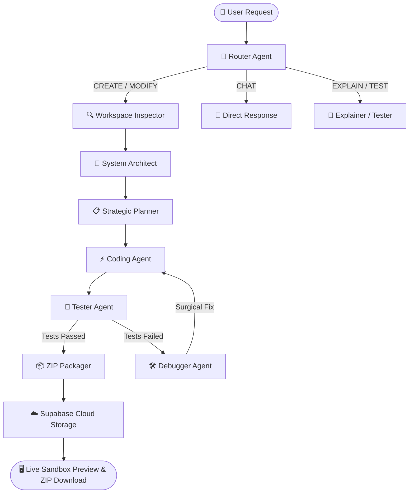

# ⚡ DevPilot (Neon Genesis) — Autonomous Agentic Software Engineering System

[](https://www.python.org/)
[](https://github.com/langchain-ai/langgraph)
[](https://groq.com/)
[](https://ai.google.dev/)
[](https://supabase.com/)
[](https://render.com/)
[](https://www.docker.com/)

An autonomous, multi-agent software engineering framework that converts plain natural language prompts into complete, fully functional, zero-build web applications delivered directly into an in-browser sandbox and packaged as downloadable ZIP archives.

---

### 🌐 Live Cloud Deployment

[](https://render.com/)
[](#-live-cloud-deployment)

> 🔗 **Deployment Platform:** Render (Docker Web Service)  
>
> 💡 **Free-Tier Sleep Notice:**  
> The application is deployed on Render's Free tier. When inactive for 15 minutes, the instance automatically sleeps to conserve resources. Accessing the web application triggers an automatic spin-up (typically 30–50 seconds).
> * **Instant Local Run:** You can run the exact production stack locally in under 30 seconds using standard Python or Docker.

---

## 🚀 Key Highlights & Engineering Features

- **End-to-End Agentic SDLC:** Moves beyond simple single-file code generation by orchestrating an 8-stage stateful software development pipeline.
- **Supabase Cloud Partitions & Auth Gateway:** Multi-tenant user authentication where each developer receives an isolated partition (`users/{user_id}/...`) that cleanly purges to 0 bytes on each new synthesis request.
- **Zero-Build Architecture:** Generates self-contained, native HTML5, modern CSS3 variables, and vanilla ES6 code that runs immediately in any browser without requiring `npm install` or compilation steps.
- **Rate Limit (TPM) Sliding-Window Pruning:** Built-in resilience mechanism preventing 413/429 token-per-minute errors on Groq by batching code writes in Turn 1 and pruning agent conversational memory.
- **Live In-Browser Sandbox Preview:** Features isolated iframe sandboxing with scoped session cookies (`devpilot_user_id`), device viewport toggles (Desktop vs. Mobile 375px), and real-time step timers.
- **Containerized & Production Ready:** Includes multi-stage `Dockerfile`, non-root execution, health check probes (`/health`), and dynamic `$PORT` binding (defaults to `10000` for Render).

---

## 📐 System Architecture (LangGraph Directed Graph)

DevPilot structures AI agents into a stateful, cyclical graph (`StateGraph`) with automated validation loops:



### Specialized Agent Responsibilities

| Agent Node | Responsibility | Core Engine |
| :--- | :--- | :--- |
| **🧭 Router** | Analyzes intent: `CREATE`, `MODIFY`, `DEBUG`, `TEST`, or `CHAT`. | Gemini 3.5 Flash-Lite / Groq Auto |
| **🔍 Inspector** | Scans workspace directory layout, existing dependencies, and files. | Sandboxed Filesystem Tools |
| **📐 Architect** | Formulates system architecture, tech stack, data flow, and UI constraints. | Groq GPT-OSS 120B (Structured) |
| **📋 Planner** | Breaks architectural design into 4–7 prioritized, sequential tasks. | Groq GPT-OSS 120B (Pydantic Schema) |
| **⚡ Coder** | Batch-emits code files via parallel tool calls with modern UX styling rules. | Groq Tool-Calling Agent |
| **🧪 Tester** | Discovers tests, executes test suites, and parses stdout/stderr. | Subprocess Executor + LLM Parser |
| **🛠️ Debugger** | Analyzes stack traces, inspects affected files, and applies targeted fixes. | Groq Reasoning Loop (Max 6x) |
| **📦 Packager** | Compresses user workspace from cloud storage into an exportable ZIP archive. | Python in-memory `zipfile` |

---

## 🛠️ Quick Start & Local Development

### 1. Prerequisites
- Python 3.11+
- [`uv`](https://github.com/astral-sh/uv) (recommended) or standard `pip`
- Free API keys from [Groq Cloud](https://console.groq.com/) and [Google AI Studio](https://aistudio.google.com/)
- (Optional) [Supabase](https://supabase.com/) project for cloud sessions

### 2. Installation & Setup

Clone the repository:
```bash
git clone https://github.com/Amberbops/lang_graph_ai_project.git
cd lang_graph_ai_project
```

Install dependencies using `uv`:
```bash
uv pip install -e .
```
*(Or with standard pip: `pip install -r requirements.txt`)*

### 3. Environment Variables
Create a `.env` file in the project root:
```env
# AI Model APIs
GROQ_API_KEY=gsk_your_groq_api_key_here
GOOGLE_API_KEY=AIzaSy_your_gemini_api_key_here

# Optional: Supabase Auth & Cloud Storage
SUPABASE_URL=https://your-project.supabase.co
SUPABASE_SERVICE_KEY=your_supabase_service_role_key

# Web Server (defaults to 10000)
PORT=10000
```

### 4. Run the Web Studio
```bash
python web_app/server.py --port 10000
```
Open **[http://localhost:10000](http://localhost:10000)** in your browser to access the Authentication Gateway and Studio Workspace.

---

## 🐳 Docker Deployment

Build and run using the optimized production container:

```bash
# Build container image
docker build -t devpilot-ai-studio .

# Run container with environment variables on port 10000
docker run -p 10000:10000 --env-file .env devpilot-ai-studio
```

Verify health check:
```bash
curl http://localhost:10000/health
# Output: {"status": "healthy", "service": "DevPilot Synthesis Gateway"}
```

---

## 📄 Documentation & Synopsis

A comprehensive, publication-quality technical report is available in the repository root:
* **PDF Synopsis:** [`SYNOPSIS.pdf`](./SYNOPSIS.pdf)

---

## 👤 Author & Maintainer

* **Author:** Amber Saluja
* **Email:** [ambersaluja20006@gmail.com](mailto:ambersaluja20006@gmail.com)
* **Repository:** [https://github.com/Amberbops/lang_graph_ai_project](https://github.com/Amberbops/lang_graph_ai_project)

---

## 📜 License
Distributed under the MIT License. See `LICENSE` for more information.
